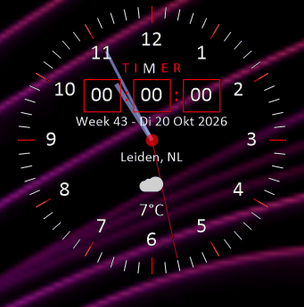

<<<<<<< HEAD
=======

>>>>>>> 2ce1c51d467d681bce3a5271dc7efd1d9aa19d11
# <ins>Adhd-Klok</ins>

Een klein bureaubladklokje voor Windows, 

gemaakt met C# en .NET 8 WinForms. 

Het klokje toont de tijd, datum, een afteltimer en het actuele weer.

# _Screenshot_

     

     

# Starten

Benodigd: de .NET 8 SDK en Windows.

dotnet run --project AdhdKlok.csproj

## Functies

-  Tijd- en datumweergave
   
-  Hert menu zit tussen de 4 en de 5
  
-  Instelbare Afteltimer en Pauzetijd met kiezen van Vier alarmgeluiden

-  Ge keuze om tijdens de pauze het scherm uit te schakelen Zo lang als de ingestelde Pauze
   let er wel op Het schermj reageerd pas op muis en toetsenbord als dew pauze voorbij is !

-  Actueel het Weer en Tempratuur via Open-Meteo

-  Donker en licht thema

-  Vast zetten op het bureaublad

-  Opstarten met Windows  

-  Uitschuifbaar instellingenmenu met animaties

-  Altijd zichtbaar op het bureaublad

# Werking

klok is randloos. Sleep het venster om het te verplaatsen en klik op het instellingen-icoon in het berichtenpaneel onderaan om het uitklapmenu te openen.

Het icoon draait kort en het menu klapt na een korte vertraging onder het icoon open. Klik nogmaals op het icoon om het menu omhoog te laten inklappen.

Via Weergave kies je het donkere thema of Licht (Windows). De keuze wordt bewaard in Data/theme.txt.

Onder Timer > Alarmgeluid kun je kiezen uit vier WAV-bestanden. De geselecteerde toon wordt gebruikt wanneer de timer afloopt.

De vensterpositie wordt opgeslagen in Data/position.txt.

Weerinformatie

Het weer wordt opgehaald via Open-Meteo en vereist geen API-sleutel of extra NuGet-pakketten.

# _Een internetverbinding is nodig voor de actuele temperatuur._

# Licentie

_Dit project valt onder de MIT License.     Copyright (c) 2026 Mario Hägele_(R)
