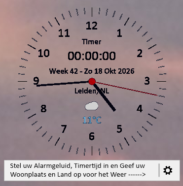

<<<<<<< HEAD
#### <ins>Adhd-Klok</ins>
=======

# <ins>Adhd-Klok</ins>
>>>>>>> e9ffba18142be9de1e7543186f78188efce45077

Een klein bureaubladklokje voor Windows, 

gemaakt met C# en .NET 8 WinForms. 

Het klokje toont de tijd, datum, een afteltimer en het actuele weer.

# _Screenshot_
<<<<<<< HEAD

     

# _Vast aan BureauBlad_

      

## Starten
=======

     

# Starten
>>>>>>> e9ffba18142be9de1e7543186f78188efce45077

Benodigd: de .NET 8 SDK en Windows.

dotnet run --project AdhdKlok.csproj

<<<<<<< HEAD

## Functies
=======
## Functies

-  Tijd- en datumweergave

-  Afteltimer met alarmgeluiden

-  Actueel weer via Open-Meteo

-  Donker en licht thema

-  Opslaan van vensterpositie

-  Uitschuifbaar instellingenmenu met animaties

-  Altijd zichtbaar op het bureaublad

# Werking
>>>>>>> e9ffba18142be9de1e7543186f78188efce45077

-  Tijd- en datumweergave

-  Aftel-timer en Pauze instellen met alarmgeluiden

- Keuze om het scherm uit te zetten zonder reackt op  muis of toetsenbord      tot de pauze over is, en herstelt na de pauze.

-  Keuze om de klok vast te zetten op bureaublad

-  Actueel weer via Open-Meteo

-  Donker en licht thema

-  Opslaan van vensterpositie

-  Keuze om met Windows op te starten

-  Uitschuifbaar instellingenmenu met animaties

-  Altijd zichtbaar op het bureaublad

## Werking

klok is randloos. Sleep het venster om het te verplaatsen en klik op het instellingen-icoon in het berichtenpaneel onderaan om het uitklapmenu te openen.

Het icoon draait kort en het menu klapt na een korte vertraging onder het icoon open. Klik nogmaals op het icoon om het menu omhoog te laten inklappen.

Via Weergave kies je het donkere thema of Licht (Windows). De keuze wordt bewaard in Data/theme.txt.

Onder Timer > Alarmgeluid kun je kiezen uit vier WAV-bestanden. De geselecteerde toon wordt gebruikt wanneer de timer afloopt.

Drie kezes: Het windows opstarten en openen op de plaats van afsluiten, Het scherm uitzetten tijdens de pauze tijd, herstelt na de aflopen van de ingestelde puaze-tijd. (Let op tijdens het uitzetten van het scherm reageerd het scherm niet op de muis en toetsenbord).
En de derde keuze is het vast zetten op het bureaublad. 

De vensterpositie wordt opgeslagen in Data/position.txt.

Weerinformatie

Het weer wordt opgehaald via Open-Meteo en vereist geen API-sleutel of extra NuGet-pakketten.

<<<<<<< HEAD
# _!!!!! Een internetverbinding is nodig voor het actueele weer en tempratuur !!!!!._

# Licentie

_Dit project valt onder de MIT License.     Copyright (c) 2026 Mario Hägele (R)_
=======
# _Een internetverbinding is nodig voor de actuele temperatuur._

# Licentie

_Dit project valt onder de MIT License.     Copyright (c) 2026 Mario Hägele_

>>>>>>> e9ffba18142be9de1e7543186f78188efce45077
