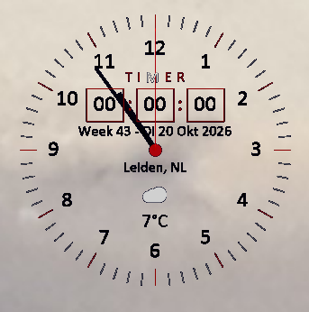

# Top Klok

Een bureaubladklokje voor Windows,

gemaakt met C# en .NET 8 WinForms.

## Focus en Pauzes

De klok is ontworpen voor mensen die gemakkelijk opgaan in hun werk, studie of hobby. Via de ingebouwde timer kun je een werkperiode en een pauzetijd instellen.

Wanneer de werktijd afloopt, start automatisch de pauze. Tijdens deze pauze kan de applicatie het scherm uitschakelen,Door het vinkje in het menu aan te zetten.

 Hierdoor word je gestimuleerd om daadwerkelijk even afstand te nemen van de computer en een korte onderbreking te nemen.

Gebruik die tijd bijvoorbeeld voor een kop koffie, iets te eten, een korte wandeling of een knuffel voor je huisdier.

## _Screenshot_

 

## Ontwikkelaars

Benodigd:

- .NET 8 SDK

- Windows 10 of 11

Starten vanuit de broncode:

dotnet run --project AdhdKlok.csproj

## Installatie

Download de laatste versie via de Releases-pagina en start de installer.

## Functies

- Tijd- en datumweergave

- Afteltimer met alarmgeluiden

- Actueel weer via Open-Meteo

- Donker en licht thema

- Opslaan van vensterpositie

- Uitschuifbaar instellingenmenu met animaties

- Altijd zichtbaar op het bureaublad

## Werking

klok is randloos. Sleep het venster om het te verplaatsen en klik op het instellingen-icoon in het berichtenpaneel onderaan om het uitklapmenu te openen.

Het icoon draait kort en het menu klapt na een korte vertraging onder het icoon open. Klik nogmaals op het icoon om het menu omhoog te laten inklappen.

Via Weergave kies je het donkere thema of Licht (Windows). De keuze wordt bewaard in Data/theme.txt.

Onder Timer > Alarmgeluid kun je kiezen uit vier WAV-bestanden. De geselecteerde toon wordt gebruikt wanneer de timer afloopt.

De vensterpositie wordt opgeslagen in Data/position.txt.

Weerinformatie

Het weer wordt opgehaald via Open-Meteo en vereist geen API-sleutel of extra NuGet-pakketten.

_Een internetverbinding is nodig voor de actuele temperatuur._

## Licentie

Dit project valt onder de MIT License. Copyright (c) 2026 Mario Hägele(R)
