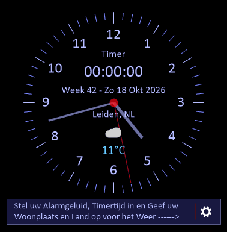

# Top Klok

Een bureaubladklokje voor Windows,

gemaakt met C# en .NET 8 WinForms.

## Focus en Pauzes

De klok is ontworpen voor mensen die gemakkelijk opgaan in hun werk, studie of hobby. Via de ingebouwde timer kun je een werkperiode en een pauzetijd instellen.

Wanneer de werktijd afloopt, start automatisch de pauze. Tijdens deze pauze kan de applicatie het scherm uitschakelen,Door het vinkje in het menu aan te zetten.
 Hierdoor word je gestimuleerd om daadwerkelijk even afstand te nemen van de computer en een korte onderbreking te nemen.

Gebruik die tijd bijvoorbeeld voor een kop koffie, iets te eten, een korte wandeling of een knuffel voor je huisdier.

## _Screenshot_

     

## Ontwikkelaars

Benodigd:

- .NET 8 SDK
- Windows 10 of 11

Starten vanuit de broncode:

dotnet run --project TopKlok.csproj

## Installatie

Download de laatste versie via de Releases-pagina en start de installer.

## Functies

- Tijd- en datumweergave

- Afteltimer met alarmgeluiden

- Actueel weer via Open-Meteo

- Taal en datumweergave op basis van de Windows-taal

- Lokale systeemtijd en landinstelling

- Donker en licht thema

- Optioneel Windows-klikgeluid voor muisklikken in de app

- Opslaan van vensterpositie

- Uitschuifbaar instellingenmenu met animaties

- Altijd zichtbaar op het bureaublad

## Werking

klok is randloos. Sleep het venster om het te verplaatsen en klik op het instellingen-icoon in het berichtenpaneel onderaan om het uitklapmenu te openen.

Het icoon draait kort en het menu klapt na een korte vertraging onder het icoon open. Klik nogmaals op het icoon om het menu omhoog te laten inklappen.

Via Weergave kies je het donkere thema of Licht (Windows). De keuze wordt bewaard in Data/theme.txt.

Via Klikgeluid aan/uit schakel je het Windows-menuklikgeluid in of uit voor muisklikken in de app. De keuze wordt bewaard.

Onder Timer > Alarmgeluid kun je kiezen uit vier WAV-bestanden. De geselecteerde toon wordt gebruikt wanneer de timer afloopt.

Sluit je het venster Timer instellen met het kruisje, dan wordt de actieve timer teruggezet naar 00:00:00.

De vensterpositie wordt in Data/position.txt opgeslagen ten opzichte van het scherm waarop de klok staat. Zo wordt de klok bij het opnieuw starten teruggezet op hetzelfde scherm en op dezelfde plek. Bestaande opgeslagen posities blijven ondersteund.

Weerinformatie

Het weer wordt opgehaald via Open-Meteo en vereist geen API-sleutel of extra NuGet-pakketten.

De app gebruikt de Windows-locatie als die beschikbaar is. De coördinaten worden naar Open-Meteo gestuurd om het lokale weer op te halen. Als locatie niet beschikbaar is of geen toestemming heeft, wordt de handmatig ingestelde plaats gebruikt. Die plaats en het land worden bewaard in `weather-location.txt`. Nederlands en Engels worden ondersteund; andere Windows-talen gebruiken Engels.

_Een internetverbinding is nodig voor de actuele temperatuur._

Tijd en timers volgen de lokale tijd van Windows.

## Licentie

Dit project valt onder de MIT License. Copyright (c) 2026 Mario Hägele(R)
